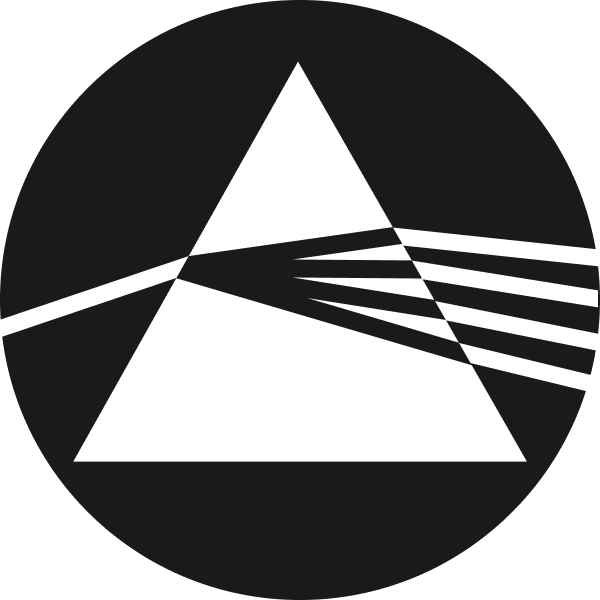

# OpenAleph commits to the commons

> Since early 2025, we have been investing resources into the open source development of the established research platform originally created by OCCRP.

<!-- more -->

{.no-border .no-shadow .center width="200"}

When it comes to making sense of data, [Aleph](https://aleph.occrp.org/) has built a reputation for being a reliable investigative tool, used in numerous cross-border journalistic investigations. 

[**OpenAleph**](https://data.openaleph.org/) is a soft fork of Aleph, the free open source software developed by the [Organized Crime and Corruption Reporting Project](https://www.occrp.org/) (OCCRP). It is developed and maintained by the Data and Research Center (DARC). Both Aleph and OpenAleph share the same [FollowTheMoney](https://followthemoney.tech/) data schema, allowing easy data migration between deployments and we are in active discussions with the OCCRP's leadership, from whom we received valuable advice on setting up OpenAleph. 

The purpose of this soft fork is to develop a new set of features while remaining compatible with Aleph's data processing methodology. After discussions with OCCRP, we mutually agreed that forking the Aleph repository was the best path forward, as we plan to give OpenAleph its own direction. 

"OCCRP has agreed to this soft fork with the goal of continuing to provide an open source version of Aleph. We appreciate the work Simon and his team at DARC have done to support organizations using the Aleph base," says Drew Sullivan, co-founder and publisher of OCCRP. 

OCCRP will continue the development of a new version of Aleph that will be free to non-profit journalists, and both organizations believe that both tools can coexist, each serving the community in its own way.

Since 2020, [investigativedata.io](https://investigativedata.io/)  provided managed Aleph instances as a service. Its founder, [Simon Wörpel](https://wrpl.de), has customized Aleph installations to meet the individual needs of investigative teams worldwide. He has been an active member of the community built around this open source tool and has regularly contributed to the upstream codebase. 

As of 2025, he is joined by a team with expertise in journalism, data research, project management and development to form the Data and Research Center ([**DARC**](https://dataresearchcenter.org/)).

Following the soft fork, **DARC** envisions **OpenAleph** as a tool that can co-exist within the same ecosystem as its predecessor. This fresh start allows the team to experiment with new features driven by the real-world needs of researchers and investigative journalists. Additionally, the soft fork allows the development team to explore roads not taken and experiment with emerging technologies. 

Storing investigative research material presents complex security and accessibility challenges. investigativedata.io has deployed Aleph instances on bare metal servers, and **DARC** [will continue this approach](../../openaleph/managed.md). 

**OpenAleph** can be deployed on demand on server infrastructure owned by **DARC** in Germany. Through an ongoing collaboration with [Flokinet](https://flokinet.is/), DARC can also offer maintained **OpenAleph** deployments in Romania, Finland, the Netherlands and Iceland.

More than ever, information, and the means to make it intelligible, must be made accessible. As [Molly White writes](https://www.citationneeded.news/free-and-open-access-in-the-age-of-generative-ai/) about free and open access in the age of generative AI, we must continue our work "*with deep respect for the communities that make the commons — and the tools that build off them — possible*."

**DARC** is committed to keeping **OpenAleph** free and open source, ensuring accessibility for all. Thus, any new features can inspire other projects and, as a result, strengthen our understanding and resilience as a community. 

*There may be live-streamed coding sessions in the future, but that's for another blog post.*
