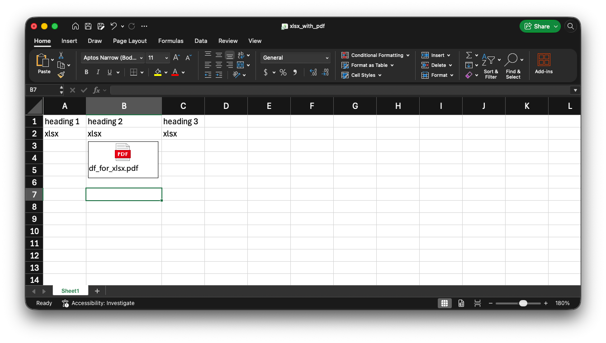
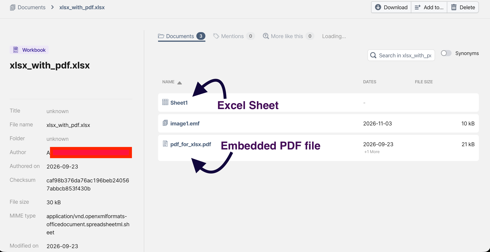

# OpenAleph Matryoshka is Here

> OpenAleph 5.4.0, codenamed Matryoshka, is here, with improved support for Microsoft Office files, faster indexing, and security updates that limit the personal data users can see in an OpenAleph instance.

<!-- more -->

Here's what's changed, and what it means for your investigations

**Getting more out of your data**

The datasets we throw into OpenAleph come in all shapes and sizes. Leaks, document dumps, and other collections often contain a mix of file formats, with useful information sometimes tucked away in unexpected places. `ingest-file`, the component that handles incoming files in OpenAleph, is responsible for getting that information out and ready to search. It extracts text and metadata, runs OCR, converts documents for display, and generates structured data.

New datasets often bring file types or edge cases we haven't accounted for. And if `ingest-file` can't handle a file, its contents may never make it into OpenAleph's search results. So we're always improving it to make sure investigators can find what's in their data, whatever format it comes in.

In this release, [we've addressed](https://github.com/openaleph/ingest-file/releases/tag/5.4.0)  two gaps: embedded files inside Microsoft Office documents, and Excel spreadsheets in the less common `.xlsb` format.

**Everything you never wanted to know about embedding files in Microsoft Office files**

Microsoft created a proprietary technology called [Object Linking and Embedding](https://en.wikipedia.org/wiki/Object_Linking_and_Embedding) (OLE), which allows users to embed or link files inside a Microsoft Office document. For example, a Microsoft Word document can contain a .zip archive. An Excel spreadsheet can hide a PDF inside a cell.

Yes, this is totally normal:

OpenAleph can now extract and process these embedded files, too. Upload an Excel spreadsheet with a PDF tucked inside a cell, and you'll get two searchable documents at the end of the processing pipeline: the original spreadsheet and its child document, the PDF.

If you suspect that Microsoft Office documents you've already uploaded to your OpenAleph instance contain embedded files, **re-ingest all the collections that contain these documents**. OpenAleph will extract the embedded files and make them searchable.

**Did you say more Excel? OpenAleph can now parse .xlsb**

Back in 2007, Microsoft introduced the Excel Binary File Format (.xlsb) as an alternative to the default .xlsx format. It's a proprietary format that supports macros.

OpenAleph can now process .xlsb documents, expanding the range of tabular data formats it can handle.

**Security improvement: e-mails are never revealed**

The Access Control menu in OpenAleph investigations can now be configured not to suggest names and e-mail addresses as users start typing. While these suggestions do make it easier to share investigations, they can also expose the e-mail addresses of other users registered on the instance. On larger instances shared by multiple newsrooms or external collaborators, this can pose a privacy risk.

We've introduced [a new configuration flag](https://darc.li/docs/openaleph/dev-admin-guide/102/configuration/#aleph_share_suggest_roles), `ALEPH_SHARE_SUGGEST_ROLES`, which OpenAleph administrators can use to control this behavior. By default, it is set to `True`, so suggestions remain enabled. For instances with open sign-ups or collaborators whose e-mail addresses shouldn't be visible to other users, we recommend setting it to `False`.

When suggestions are disabled, users must enter the full, correct e-mail address of another registered user to share an investigation with them.

**We make data searchable, faster**

OpenAleph 5.4.0 also brings faster indexing with less storage footprint, meaning that newly uploaded data becomes fully searchable in less time. Two changes to how Elasticsearch stores and processes search information made this possible:

- **We disabled [`term_vector`](https://www.elastic.co/docs/reference/elasticsearch/mapping-reference/term-vector)position storage in Elasticsearch.** These positions help OpenAleph highlight matching terms in search results more efficiently, but storing them increases the size of the index and the time it takes to process new data.
- **We disabled Elasticsearch's [`index_phrases`](https://www.elastic.co/docs/reference/elasticsearch/mapping-reference/index-phrases) feature.** This feature is designed to improve searches using quoted phrases, but it also increases the size of the index and adds to indexing time.

In our internal tests on production deployments, we haven't observed a consistent drop in search accuracy as a result of disabling these two features. Meanwhile, the time needed to index new information has decreased significantly.

Administrators who want to take advantage of these changes will need to perform a [full rebuild of their instance's Elasticsearch index](https://darc.li/docs/openaleph/dev-admin-guide/103/reindex/). Simply re-indexing individual collections through the OpenAleph UI won't apply the changes to the existing index. The good news is that these optimizations also make a full index rebuild much faster than it used to be.

With these updates, OpenAleph can get more information out of your datasets, make it searchable faster, and give administrators more control over how users share investigations. As always, we're working to make more of your data searchable and easier to work with securely.

We're looking forward to hearing what you think of these updates, and whether re-ingesting your older datasets has turned up any hidden documents or useful information you might have missed the first time around.
