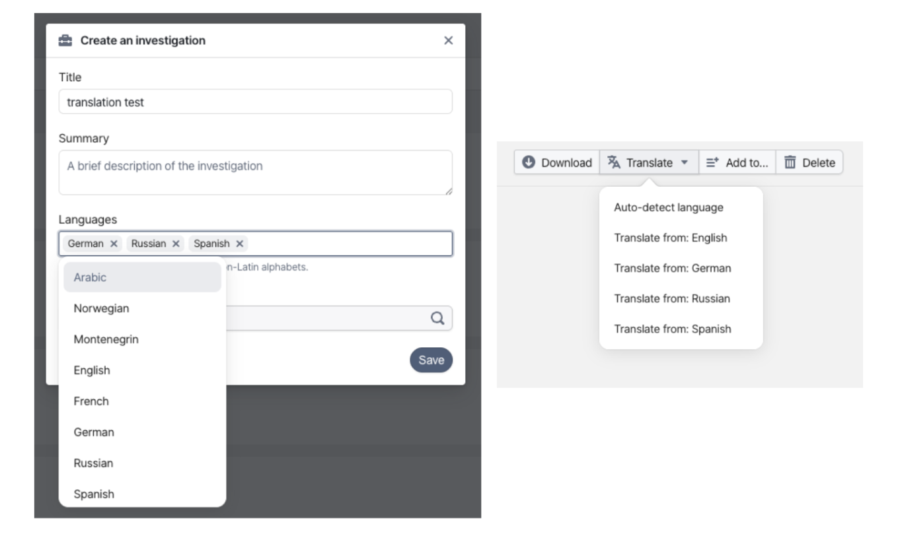
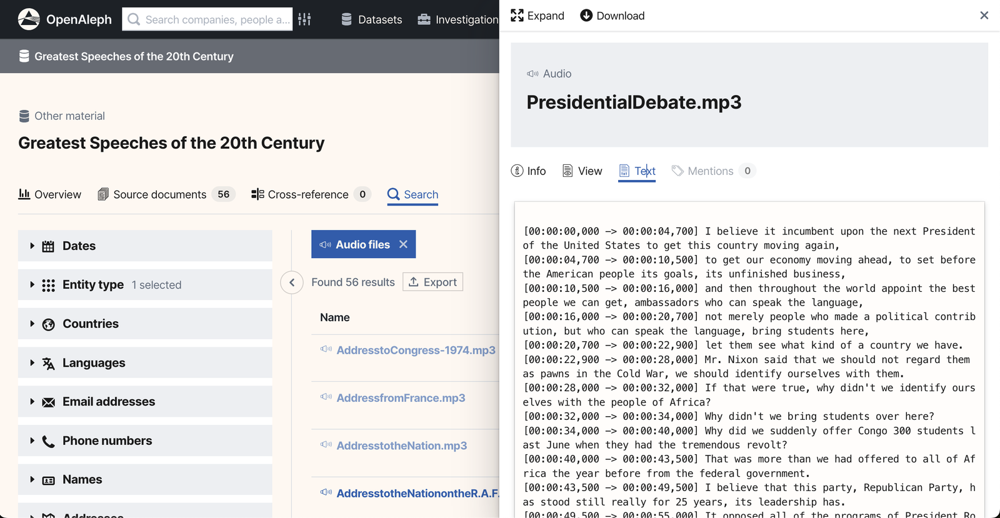
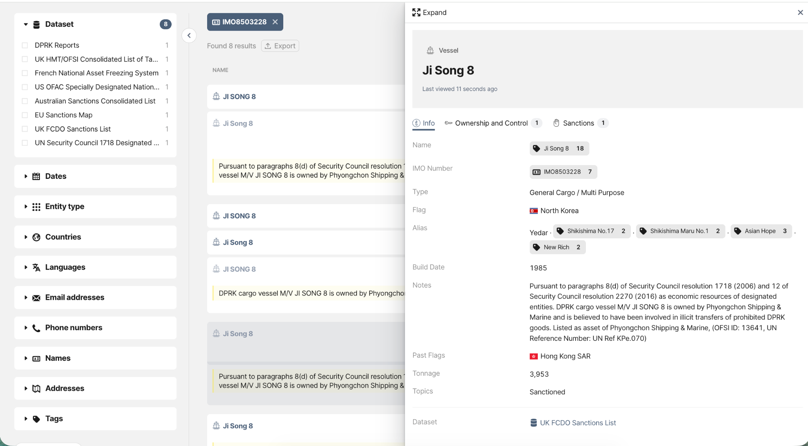
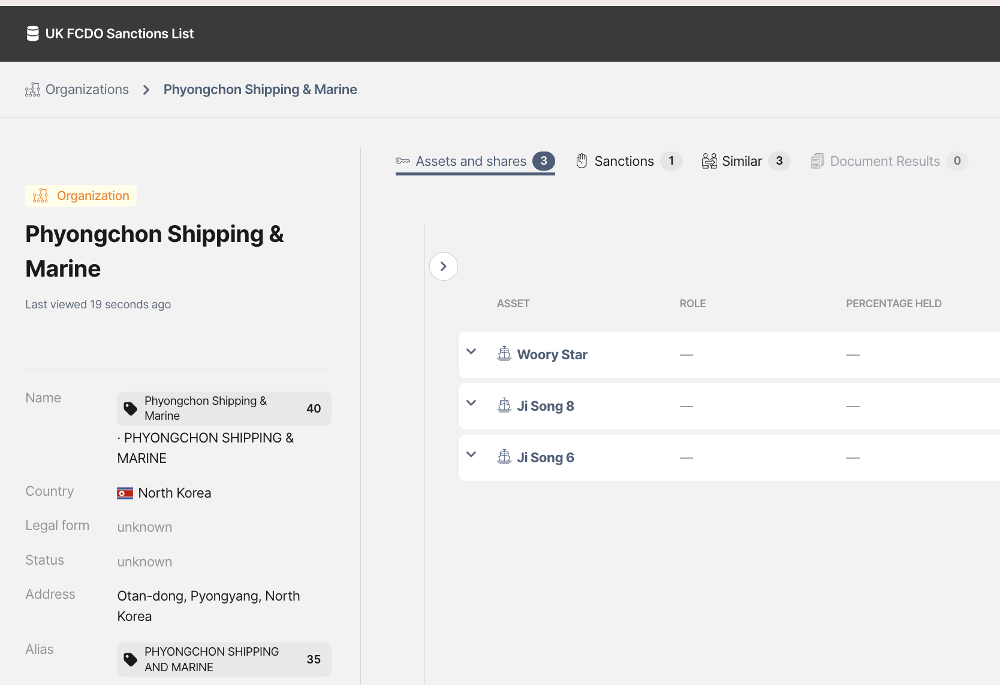
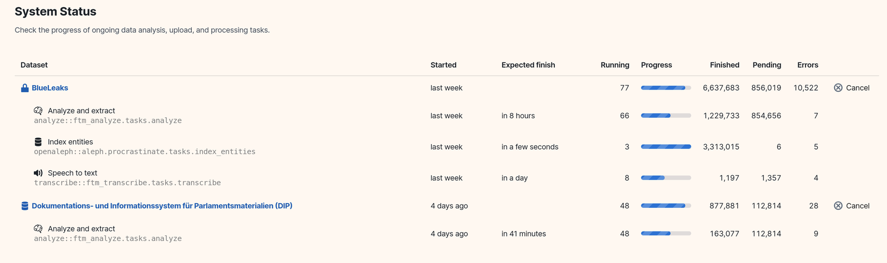

<!-- The open source project on one page, merged from the openaleph.org pages
     (home, start, faq, about; redirects: contrib/nginx.map). The managed
     service has its own page, openaleph/managed.md. -->

<section class="screen screen--bg-white" markdown>

{.no-border .no-shadow style="aspect-ratio:1/1"}

# Welcome to OpenAleph

The open source platform that securely stores large amounts of data and makes it searchable for easy collaboration.

[Get started](#get-started){.btn} [OpenAleph live](https://search.openaleph.org){.btn .btn--primary}

</section>

<section class="screen screen--bg-yellow" markdown>

## Upload

Anyone seeking a better understanding of their data can have OpenAleph at their fingertips. The software is straightforward to deploy and navigate. Data can be uploaded via a web application or through a command-line interface. OpenAleph can handle both structured and unstructured data.

[Learn more](https://openaleph.org/docs/user-guide/103/investigations/){.btn}

## Process

Data is often messy, but OpenAleph helps make sense of it. With an extensible ingestion pipeline, documents can be made searchable through OCR, audio and video can be transcribed, and key entities of interest float to the top. OpenAleph helps you find leads and connections quickly and makes it easy to share them with your collaborators.

[Learn more](https://openaleph.org/docs/lib/ingest-file/){.btn}

## Search

You've got a haystack, and you're looking for a needle. OpenAleph's search lets you use precise, structured queries to find it, while also giving you the freedom to use keyword searches, logic operators, and filters.

[Learn more](https://openaleph.org/docs/user-guide/101/basic-search/){.btn}

## Collaborate

OpenAleph allows you import data and export search results. Collaboration is made easy because all stored data is structured using the standard [FollowTheMoney](https://followthemoney.tech/) schema.

[Community](https://darc.social){.btn .btn--primary}

</section>

<section class="screen screen--bg-green" markdown>

**Get involved**

## Do it yourself {#get-started}

Clone our repo and get started. If you get stuck, the documentation is here to support you.

[Github](https://github.com/openaleph/openaleph){.btn} [Documentation](https://openaleph.org/docs){.btn .btn--primary}

</section>

<section class="screen screen--bg-white" markdown>

## Frequently Asked Questions {#faq}

### About OpenAleph

**What is OpenAleph?**

OpenAleph is an open source data search platform designed to help users explore large collections of documents, datasets, and structured data. It enables powerful full-text search, entity extraction, and relationship mapping. OpenAleph is specifically built for 'follow the money' type investigations across a variety of data sources.

**Does OpenAleph rely on Google, Amazon or other big tech service providers?**

Not unless you want it to. OpenAleph is designed to run entirely on infrastructure you control and does not depend on any proprietary cloud services from Google, Amazon, or other major tech providers. You can deploy it on-premise or in a hosting environment of your choice, with full ownership of your data and operations.

**Why is OpenAleph open source?**

We believe transparency, collaboration, and accessibility are essential for building trustworthy tools for research and investigations. By keeping OpenAleph open source, we enable independent audits, foster community contributions, and ensure the platform remains free and adaptable for diverse use cases, from journalism and academic research to civil society work. If there's a feature you're missing, [get in touch](https://dataresearchcenter.org/contact/) to learn how you can sponsor its development!

**My friend from NEWSROOM XYZ found a document in OpenAleph, but I can't see it with my account – why not?**

OpenAleph is open source software that can be deployed by different organizations, each operating their own independent instance. If your colleague found a document in their organization's instance, it won't be visible to you unless that instance is public or you've been granted access. Each deployment controls its own data, user permissions, and visibility settings. They don't speak to each other (yet! See our roadmap linked below).

### Data and Usage

**What data formats can I import?**

OpenAleph supports a variety of file types, among them PDFs, Word documents, spreadsheets, emails (including PST and MBOX), and various structured formats like CSV. Since release 4.0 OpenAleph supports text extraction (and therefore full text search) for audio and video material of all kinds and languages. 

**Can I connect OpenAleph to other data sources?**

Yes. You can ingest data manually or through automated pipelines. Integration with external sources can be customized using the OpenAleph API. At DARC, the team behind OpenAleph, we run a [fleet of scrapers](https://dataresearchcenter.org/library/) that integrate with the platform. If you want to learn more about the data we're ingesting into our OpenAleph instances, please [reach out](https://dataresearchcenter.org/contact/).

**How does search and indexing work?**

Data is indexed using Elasticsearch, allowing for full-text search, entity extraction, and faceted filtering. Documents are processed with natural language tools to extract people, organizations, and other entities.

**Can I run it offline?**

In theory, yes. OpenAleph can be deployed and used entirely in an offline environment, which is useful for secure or air-gapped settings. It's main purpose, however, is to serve small teams over the internet. We take security very seriously, and there are a number of measures in place to make sure permissions are handled correctly and user authentication is secure.

### Security and Deployment

**How can I deploy OpenAleph?**

OpenAleph is meant to run on a server, it is not intended to be used on a personal computer. Installation guides and configuration instructions are available in our [documentation](https://openaleph.org/docs/).

**What data models does OpenAleph support?**

OpenAleph builds on the *FollowTheMoney&#32;*(FtM) data schema, which is specifically designed for anti-corruption investigations and used in many industry grade applications. You can learn more about FtM [here](https://followthemoney.tech/).

**Is there an API?**

Yes, OpenAleph provides a RESTful API for programmatic access to all core features, including document upload, search, and metadata queries. You can find the [API documentation here](https://redocly.github.io/redoc/?url=https://search.openaleph.org/api/2/openapi.json).

**Is OpenAleph secure for sensitive investigations?**

Yes, when properly configured. We recommend deploying OpenAleph behind a firewall with a properly configured reverse proxy, using HTTPS, setting up an intrusion detection system, and enabling role-based access control for multi-user setups. If you need help with this, [please reach out to us](https://dataresearchcenter.org/contact/).

### Development and Contribution

**Can I see the OpenAleph source code?**

Yes. OpenAleph is fully open source under the [MIT license](https://github.com/investigativedata/aleph#MIT-1-ov-file) and available on GitHub. You can inspect [the repository here](https://github.com/openaleph).

**How can I contribute?**

You can contribute by submitting issues, suggesting features, or opening pull requests. See our [contributor guide](https://github.com/openaleph/openaleph/blob/main/CONTRIBUTING.md) for details.

**What’s your roadmap?**

We share and discuss updates on upcoming features, priorities, and long-term goals in our Discourse forum. Feedback from users helps shape future development. You can view the [roadmap here](https://darc.social/t/openaleph-roadmap/25).

**Where can I report issues or bugs?**

Please use our [GitHub issue tracker](https://github.com/openaleph/openaleph/issues) to report bugs, request features, or ask technical questions.

### OpenAleph and Aleph

**What’s the relationship between OpenAleph and the original Aleph project?**

OpenAleph is an independent fork of Aleph. While it builds on Aleph’s foundation, it is maintained separately and may evolve differently over time. Read [here](blog/posts/2025-03-31-openaleph-commits-to-the-commons.md) about the history of Aleph and OpenAleph.

**I’m already using Aleph - can I migrate to OpenAleph?**

Yes. OpenAleph maintains compatibility with most existing Aleph installations.

</section>

<section class="screen screen--bg-purple" markdown>

## About

### Who's behind OpenAleph

OpenAleph is an open source tool that's primarily developed by the [Data and Research Center](https://dataresearchcenter.org). It builds on the work of many excellent contributors that went into it's predecessor [Aleph](https://github.com/alephdata/aleph). Read more about why we've decided to continue developing OpenAleph [in our blog](blog/posts/2025-03-31-openaleph-commits-to-the-commons.md).

### We love hearing from you!

Have you found a bug in OpenAleph? Open an Issue in the [repository](https://github.com/openaleph/openaleph), or get in touch with us at [hi@dataresearchcenter.org](mailto:hi@dataresearchcenter.org). If you want to get involved, fork the repo and send us a pull request. 

We also run a [community platform](https://darc.social) to chat about all things OSINT and OpenAleph and we would love to hear from you there!

### Support the development

Development of open source software, especially long-term maintenance, comes at cost. We are looking for sponsors and are happy that these organizations have already commited to support us with their resources, technology and advice:

- [FlokiNET](https://flokinet.is)
- [OpenSanctions](https://opensanctions.org)

If you want to support the long-term development of OpenAleph and ensure the openness and availability of this great software, [please get in touch](mailto:hi@dataresearchcenter.org)!

</section>
